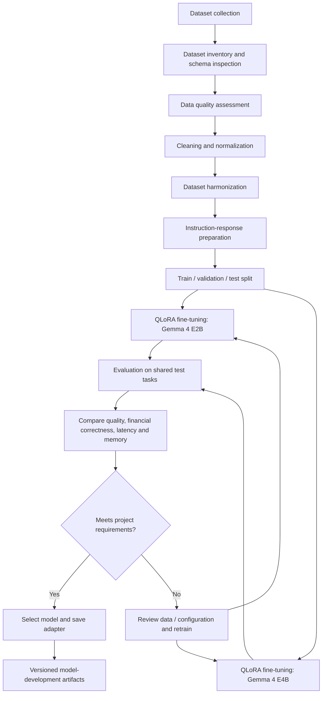

# Personal Finance Recommendation System
## Research and Model Development Architecture (QLoRA Fine-Tuning)

This repository documents the **research and model-development pipeline** for a Personal Finance Recommendation System. The work covers dataset collection, data preprocessing, QLoRA fine-tuning of Gemma 4 E2B and Gemma 4 E4B, comparative evaluation, and model selection.

> **Scope:** This README describes the model-development/research phase. The mobile application, hybrid inference services, and full RAG integration are planned application components unless separately implemented and tested.

## Architecture overview


The pipeline has five main stages:

1. **Dataset collection** – obtain relevant financial transaction, personal-finance, and finance question-answering data.
2. **Data preprocessing** – inspect, clean, normalize, deduplicate, and transform datasets into consistent training examples.
3. **QLoRA fine-tuning** – fine-tune Gemma 4 E2B and Gemma 4 E4B independently using quantized base models and LoRA adapters.
4. **Model comparison** – evaluate both variants using the same held-out test tasks and comparable settings.
5. **Model selection** – select the model that provides the best balance of financial answer quality, reliability, resource use, and deployment feasibility.

## 1. Dataset collection

Collect datasets that represent personal banking and personal-finance tasks rather than relying only on credit-card fraud or credit-risk datasets.

Potential sources include:

- **Kaggle:** financial transaction, expense/income, and personal-finance datasets.
- **Hugging Face:** personal-finance question-answering datasets, including FIQA-style data.
- **GitHub research datasets:** financial reasoning and question-answering resources such as ConvFinQA and TAT-QA, subject to license and suitability checks.
- **Additional sources:** expense-category datasets, budget examples, and approved financial knowledge documents.

### Target data types

| Data type | Intended use |
|---|---|
| Income and expense transactions | Spending analysis and transaction categorization |
| Transaction descriptions and categories | Merchant/description normalization and expense classification |
| Budget and savings examples | Budget and savings recommendation tasks |
| Finance question-answer pairs | Conversational finance Q&A |
| Financial reasoning examples | Multi-step financial question answering |
| Bank-statement samples | Testing statement parsing and transaction extraction |

Record each dataset's source, license, format, schema, row count, and known limitations. Do not combine datasets until their fields and meanings have been checked.

## 2. Data preprocessing

Preprocessing should produce a consistent, auditable dataset while preserving the meaning of each financial record.

### Recommended steps

1. **Inventory and schema inspection**
   - List files, formats, columns, data types, and row counts.
   - Identify incompatible or ambiguous fields.
2. **Data quality assessment**
   - Measure missing values, duplicate records, invalid values, and inconsistent categories.
   - Distinguish a genuinely missing value from a valid empty string or a value such as zero.
3. **Cleaning**
   - Remove fully duplicated records where appropriate.
   - Resolve duplicate transactions using a documented key and review rules; do not assume identical amounts always mean duplicate transactions.
   - Drop columns only when they are empty or irrelevant, and record the decision.
4. **Normalization**
   - Standardize dates, currency representation, signs for income/expenses, category labels, and text encoding.
   - Preserve original values when transformations could lose information.
5. **Dataset harmonization**
   - Map source-specific columns into a common schema.
   - Keep source-dataset identifiers for traceability.
6. **Training-example preparation**
   - Convert suitable records into instruction/input/response examples.
   - Remove or mask personal identifiers and sensitive account information.
   - Check that answers are supported by the source data.
7. **Dataset splitting**
   - Create training, validation, and test sets.
   - Prevent leakage by keeping related records or examples from the same source/user/time period in a single split where appropriate.

### Example canonical transaction schema

| Field | Description |
|---|---|
| `transaction_id` | Source or generated record identifier |
| `transaction_date` | Standardized transaction date |
| `description` | Normalized transaction description |
| `amount` | Numeric transaction amount |
| `currency` | Currency code, where known |
| `transaction_type` | Income, expense, transfer, or unknown |
| `category` | Standardized spending category |
| `source_dataset` | Dataset from which the record originated |

Do not invent missing transaction details. Keep unknown values explicitly unknown and document any imputation.

### Example instruction-tuning record

```json
{
  "instruction": "Summarize the user's spending by category.",
  "input": "Food: 250; Transport: 100; Utilities: 150. Currency: [currency]. Period: [period].",
  "output": "Food is the largest spending category in the supplied summary. Total spending is 500 [currency]."
}
```

This is an illustrative format only. The actual output must be generated from verified data and must not imply that example values are real user transactions.

## 3. QLoRA fine-tuning

Fine-tune the two model variants in separate, reproducible runs:

- Gemma 4 E2B
- Gemma 4 E4B

Use the same task definitions, dataset splits, evaluation prompts, and comparable training settings wherever technically possible.

### Training approach

1. Load the permitted pretrained base model and tokenizer.
2. Configure supported 4-bit quantization.
3. Prepare the model for low-bit training.
4. Attach LoRA adapters to supported target modules.
5. Train on the prepared instruction dataset.
6. Evaluate on validation data and save the best adapter.
7. Preserve configuration, random seed, package versions, and training logs.

### Main technologies

- Python
- PyTorch
- Hugging Face Transformers
- Hugging Face Datasets
- PEFT
- bitsandbytes, where supported by the model and runtime
- Google Colab / GPU runtime, depending on available hardware

**Compatibility check:** verify the selected Gemma checkpoint's model architecture, Transformers version, quantization support, and PEFT target modules before training. Do not assume every model variant supports an identical QLoRA configuration.

### Artifacts to save

```text
artifacts/
├── gemma4_e2b/
│   ├── adapter/
│   ├── tokenizer_or_reference/
│   └── training_config.json
├── gemma4_e4b/
│   ├── adapter/
│   ├── tokenizer_or_reference/
│   └── training_config.json
└── evaluation/
    ├── test_results.json
    └── comparison_report.md
```

The base model may be stored separately from the adapter. A LoRA adapter is not a complete standalone model.

## 4. E2B and E4B comparison

Evaluate both models on the same held-out test set. Include both automated metrics and human review because a fluent answer can still be financially incorrect.

| Evaluation area | What to measure |
|---|---|
| Answer quality | Relevance, clarity, completeness |
| Financial correctness | Correct calculations and interpretation of supplied data |
| Instruction following | Whether the model follows the requested task and output format |
| Groundedness | Whether claims are supported by the provided context |
| Safety | Unsupported financial claims, risky advice, and appropriate uncertainty |
| Latency | Time to generate a response |
| Memory use | Peak GPU/RAM use during evaluation and inference |
| Context handling | Performance on longer inputs and multiple transactions |

Report the test-set size, evaluation method, hardware, software versions, and model configuration. Use identical test examples for both variants.

## 5. Model selection

Select a model based on measured results, not parameter count alone.

Suggested decision criteria:

- Financial correctness and groundedness meet the project's acceptance threshold.
- The model follows instructions consistently.
- Latency and memory requirements are acceptable for the intended inference environment.
- The model handles the expected statement summaries and retrieval context.
- The model's limitations and failure cases are documented.

The outcome should be a selected base-model version plus its fine-tuned adapter, tokenizer/configuration references, and evaluation report. If neither model meets the acceptance criteria, revise the data or training setup rather than declaring a winner.

## Research pipeline flowchart

The following Mermaid diagram is editable in GitHub and other Markdown tools that support Mermaid.



## Project status: implemented vs proposed

Update this table as development progresses. A stage should be marked **Implemented** only when code, outputs, or test evidence are available.

| Component | Status | Evidence to retain |
|---|---|---|
| Dataset collection | In progress / verify | Source list, licenses, downloaded files |
| Data preprocessing | In progress / verify | Cleaning notebook, quality reports, processed datasets |
| Training-example preparation | Planned / verify | Dataset samples and validation checks |
| Gemma 4 E2B QLoRA | Planned / verify | Training logs and saved adapter |
| Gemma 4 E4B QLoRA | Planned / verify | Training logs and saved adapter |
| E2B/E4B evaluation | Planned | Shared test set and comparison report |
| Model selection | Planned | Selection rationale and model artifacts |
| RAG integration | Proposed application component | Retriever tests, knowledge-base sources, groundedness evaluation |
| Mobile application and hybrid deployment | Proposed application component | App build, API tests, device performance and privacy tests |

## Privacy, responsible use, and limitations

- Use datasets only in accordance with their licenses and terms.
- Remove or mask personal identifiers before training.
- Do not place real bank statements, credentials, or account numbers in public repositories.
- Do not use private user statements for model training without explicit permission and appropriate safeguards.
- Treat model outputs as informational assistance, not guaranteed financial advice.
- Investment-related outputs require additional risk controls, suitability checks, and clear disclosures.
- Keep deterministic financial calculations outside the language model and verify them before presenting results.

## Suggested repository structure

```text
personal-finance-recommendation-system/
├── README.md
├── research_model_development_architecture.png
├── notebooks/
│   ├── 01_dataset_collection_and_preprocessing.ipynb
│   ├── 02_gemma4_e2b_qlora_finetuning.ipynb
│   ├── 03_gemma4_e4b_qlora_finetuning.ipynb
│   └── 04_model_evaluation_and_comparison.ipynb
├── data/
│   ├── raw/                 # Keep private / do not commit sensitive data
│   ├── interim/
│   └── processed/
├── src/
│   ├── data/
│   ├── training/
│   └── evaluation/
├── configs/
├── artifacts/               # Usually stored outside Git
└── reports/
```

## Reproducibility checklist

- [ ] Dataset sources and licenses documented
- [ ] Raw data kept separate from processed data
- [ ] Cleaning and transformation decisions recorded
- [ ] Train/validation/test split saved and reproducible
- [ ] E2B and E4B training configurations saved
- [ ] Random seeds and software versions recorded
- [ ] Both models evaluated on the same test examples
- [ ] Financial correctness and safety reviewed
- [ ] Model selection supported by evaluation evidence
- [ ] Sensitive data and model artifacts excluded from public Git commits where appropriate

## Next phase

After model selection, the selected model can be integrated into the proposed hybrid mobile application. That phase will add transaction analytics, RAG retrieval, secure inference, and the mobile user interface. These application components are outside the scope of this research-pipeline README.
